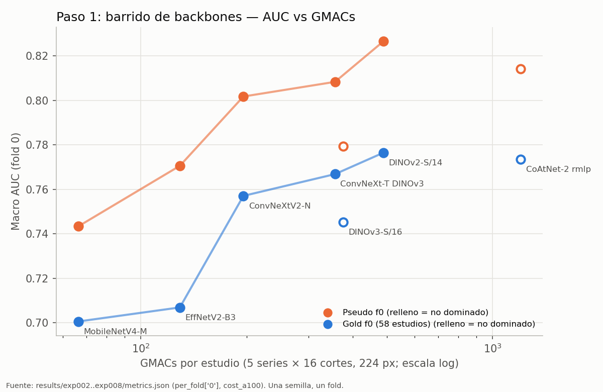
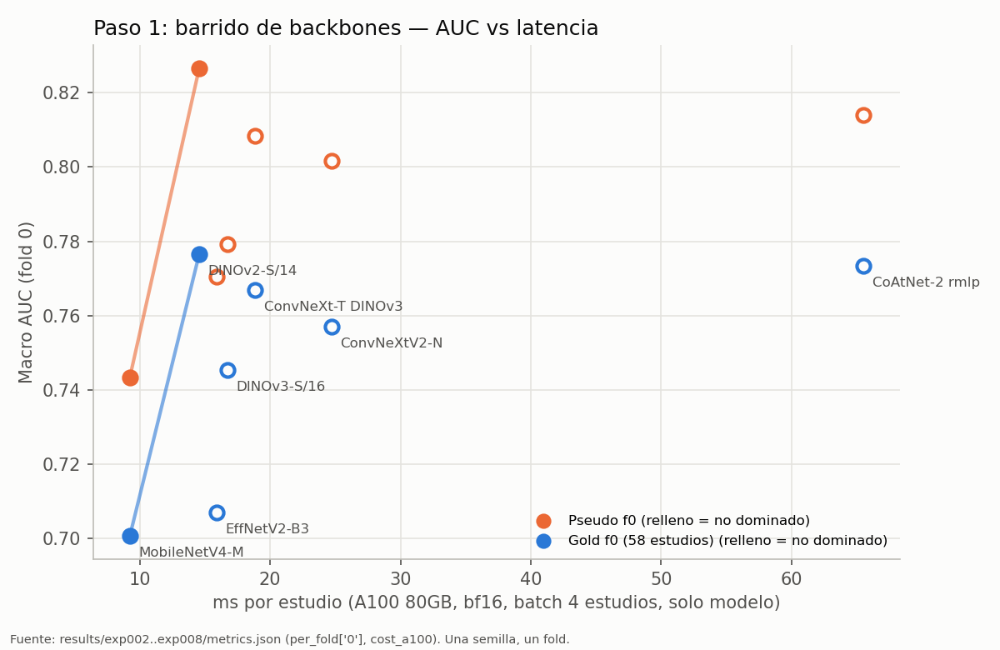

# Análisis de eficiencia del paso 1 (barrido de backbones, exp002–exp008)

Fecha: 2026-10-08. Fuentes: `results/exp002..exp008/metrics.json`, `results/exp009_preparacion_v2/metrics.json`,
`experiments/exp003..exp008/SPEC.md` (verdicts), `src/knee/cost.py`, `docs/10_PLAN_PAPER.md`,
`docs/paper/NOVEDAD_EVAL.md`. Figuras: `docs/figs/paso1_pareto_gmacs.png`, `docs/figs/paso1_pareto_latencia.png`.

Etiquetas usadas en este documento:
- **[M]** medido (sale tal cual de un `metrics.json`).
- **[D]** derivado aritméticamente de valores medidos (división, multiplicación por 1300, etc.).
- **[E]** estimado con un supuesto declarado. No es una medición.
- **[?]** desconocido: no hay medición en el repo.

## 0. Cómo se midió el costo (y qué no mide)

`src/knee/cost.py::measure_cost`:
- **GMACs [M]**: `torch.utils.flop_counter.FlopCounterMode` sobre un estudio ficticio de `MAX_SERIES × N_SLICES` cortes
  (5 × 16 = 80 cortes, 224 px, 3 canales), todas las series presentes (`mask` = 1). FLOPs / 2 = MACs.
  Cuenta el **modelo completo**: backbone + `slice_pool` + embeddings de metadatos + `series_pool` + cabeza.
  La agregación no se midió por separado; por estructura (dos `AttentionPool` sobre 16 cortes y 5 series de un vector
  de 384–768 dims) es despreciable frente a 80 pasadas del backbone **[E]**, así que GMACs/corte ≈ GMACs/estudio / 80.
- **Latencia [M]**: `model.eval()`, `torch.autocast(bfloat16)`, batch de **4 estudios** (320 cortes), 2 de calentamiento,
  10 repeticiones, `cuda.synchronize`. Resultado en ms por estudio. **Solo el forward del modelo**: no incluye leer ni
  decodificar DICOM, ni preprocesado, ni copiar a GPU, ni arrancar el notebook.
- Hay dos mediciones por experimento: `cost` (dentro del run) y `cost_a100` (medición aparte en la misma A100 80GB PCIe,
  copiada de `results/paso1_cost_a100.json`). Uso **`cost_a100`** porque es la única homogénea (misma GPU para los 7).
  Las dos discrepan mucho en algunos casos [M]: ConvNeXtV2-N 60.8 vs 24.7 ms, ConvNeXt-T DINOv3 67.2 vs 18.9 ms,
  MobileNetV4-M 20.7 vs 9.2 ms. La medición con 10 repeticiones es ruidosa; las diferencias de pocos ms entre
  14 y 25 ms no son robustas.
- **No hay** en ningún `metrics.json`: memoria pico, energía, latencia en T4 o CPU, ni pseudo/gold por época
  (solo `best_epoch`, que es 8 = la última en los 7 casos de fold 0).

## 1. Tabla por backbone (fold 0, una semilla)

Protocolo común: 224 px, 5 series × 16 cortes = 80 cortes por estudio, 8 épocas (1 congelada), lr cabeza 1e-4,
**lr backbone 1e-5**, etiquetas v1, `split_v1_seed42`. Δ contra exp002 fold 0 (pseudo 0.8266, gold 0.7765).

| exp | Backbone | Familia | Params (M) [M] | GMACs/corte [D] | GMACs/estudio [M] | ms/estudio A100 [M] | Estudios/s A100 [D] | GPU-h f0 [M] | Pseudo f0 [M] | Gold f0 [M] | Δ pseudo | Δ gold | Gold/100 GMAC [D] | (Gold−0.5)/100 GMAC [D] | Estado |
|---|---|---|---|---|---|---|---|---|---|---|---|---|---|---|---|
| exp002 | DINOv2-S/14 | ViT | 23.4 | 6.12 | 489.9 | 14.6 | 69 | 1.46 (RTX PRO 6000¹) | 0.827 | 0.776 | — | — | 0.158 | 0.056 | referencia |
| exp003 | MobileNetV4-M | CNN | 23.2 | 0.83 | 66.4 | 9.2 | 108 | 1.94 (A100) | 0.743 | 0.701 | −0.083 | −0.076 | 1.055 | 0.302 | killed |
| exp004 | EfficientNetV2-B3 | CNN | 34.1 | 1.61 | 129.1 | 15.9 | 63 | 2.99 (A100) | 0.771 | 0.707 | −0.056 | −0.070 | 0.548 | 0.160 | killed |
| exp005 | ConvNeXtV2-Nano | CNN | 18.7 | 2.45 | 195.7 | 24.7 | 40 | 2.93 (A100) | 0.802 | 0.757 | −0.025 | −0.019 | 0.387 | 0.131 | didnt |
| exp006 | DINOv3-S/16 | ViT | 22.9 | 4.70 | 375.9 | 16.7 | 60 | 0.78 (RTX 4090) | 0.779 | 0.745 | −0.047 | −0.031 | 0.198 | 0.065 | killed |
| exp007 | ConvNeXt-T DINOv3 | CNN | 33.2 | 4.46 | 356.5 | 18.9 | 53 | 2.41 (A100) | 0.808 | 0.767 | −0.018 | −0.010 | 0.215 | 0.075 | didnt |
| exp008 | CoAtNet-2 rmlp | Híbrido | 82.3 | 15.02 | 1201.7 | 65.5 | 15 | 3.62 (A100) | 0.814 | 0.773 | −0.012 | −0.003 | 0.064 | 0.023 | didnt |

¹ GPU de exp002 según la tabla de verdict de las SPEC; el `metrics.json` de exp002 no guarda la GPU de entrenamiento.
Los GPU-h no son comparables entre sí (tres GPUs distintas, distinto `N_WORKERS`, `gradient_checkpointing` en los timm).

Sobre "AUC por GMAC": `gold/GMAC` premia trivialmente al modelo más pequeño porque el AUC nunca baja de 0.5. La columna
`(gold − 0.5)/GMAC` (AUC por encima del azar por unidad de cómputo) es más honesta, y aun así **no es lo que optimiza
Kaggle**: la fórmula es lineal en AUC y en segundos, no un cociente (sección 3). Ninguna de las dos columnas debería
usarse para decidir.

## 2. Frente de Pareto (maximizar AUC, minimizar costo)

Calculado sobre los 7 puntos de fold 0 [D].

| Eje de costo | Métrica | No dominados | Dominados |
|---|---|---|---|
| GMACs/estudio | gold f0 | MobileNetV4-M, EfficientNetV2-B3, ConvNeXtV2-N, ConvNeXt-T DINOv3, DINOv2-S | DINOv3-S (por ConvNeXt-T DINOv3), CoAtNet-2 (por DINOv2-S) |
| GMACs/estudio | pseudo f0 | ídem | ídem |
| ms/estudio A100 | gold f0 | MobileNetV4-M, DINOv2-S | los otros 5 (todos por DINOv2-S) |
| ms/estudio A100 | pseudo f0 | MobileNetV4-M, DINOv2-S | los otros 5 (todos por DINOv2-S) |

Lectura:
1. **GMACs y latencia no ordenan igual.** En GMACs el frente tiene 5 puntos; en tiempo real (A100) solo 2. EfficientNetV2-B3
   tiene −74 % GMACs y es +9 % más lento; ConvNeXtV2-N −60 % GMACs y +70 % ms. Throughput efectivo [D]: DINOv2-S
   489.9 GMAC / 14.6 ms ≈ 34 TMAC/s; MobileNetV4-M 66.4 / 9.2 ≈ 7 TMAC/s; EffNetV2-B3 ≈ 8 TMAC/s. Las CNN con
   convoluciones depthwise usan la A100 4–5 veces peor que el ViT (limitadas por memoria y lanzamiento de kernels, no por
   cómputo). **Esto es específico de GPU grande con batch 4**: en T4 o CPU la relación GMACs↔tiempo puede ser otra [?].
2. **DINOv2-S domina en tiempo a 5 de 6 alternativas.** Solo MobileNetV4-M es más rápido (−5.3 ms/estudio) y lo paga
   con −0.076 de gold.
3. **CoAtNet-2 está dominado en los dos ejes** aunque es el que más se acerca en AUC (gold −0.003): ×2.45 GMACs y ×4.5 ms.
4. Cautela estadística: un fold, una semilla, gold de 58 estudios (IC por etiqueta ~±0.15 según `10_PLAN_PAPER.md`).
   El propio exp002 varía entre folds de 0.738 a 0.827 en pseudo [M]. Diferencias de ±0.01–0.02 entre exp005, exp007,
   exp008 y exp002 no están resueltas por estos datos; sí lo están las de −0.05 a −0.08 (exp003, exp004, exp006).

## 3. Runtime en Kaggle y Efficiency Score

### 3.1 Fórmula y tipo de cambio

`Efficiency = AUC / (Benchmark − maxAUC) + RuntimeSeconds / 32400`, gana el menor; Benchmark = 0.5; maxAUC ≈ 0.965 es
un **supuesto** (`NOVEDAD_EVAL.md`), el real se conoce al cierre.

- 0.01 AUC ≡ 32400 · 0.01 / 0.465 = **697 s** de runtime [D].
- **1 minuto ahorrado compensa 0.00086 de AUC** (60 · 0.465 / 32400) [D]. 10 min ≈ 0.0086; 1 h ≈ 0.052.
- Por estudio (1300 en test): 1 s/estudio = 1300 s ≈ **0.019 de AUC**; 10 ms/estudio = 13 s ≈ 0.0002 de AUC.
- Las diferencias de score entre dos candidatos no dependen del maxAUC salvo por el factor 1/0.465; el valor absoluto sí.

### 3.2 Desglose del runtime para ~1300 estudios

| Fase | Valor | Tipo | Fuente / supuesto |
|---|---|---|---|
| Decodificar DICOM en Kaggle | **desconocido** | [?] | No hay medición en Kaggle en el repo. |
| Proxy de decodificación (pod, no Kaggle) | 0.43 s/estudio → ~554 s para 1300 | [D] | `exp009.cache_v2.wall_min` = 31.33 min para 4,410 estudios (20,790 series, 663,977 cortes ≈ 151 cortes/estudio), 8 workers, **incluye remuestreo a 0.5 mm y escritura del cache**. CPU del pod no registrada. |
| Proxy de lectura de cabeceras | 0.46 s/estudio (~186 ficheros/estudio) | [D] | `exp009.read_minutes` = 33.92 min, 819,635 ficheros, 16 hilos. No se sabe si lee píxeles. |
| Backbone + agregación, A100 | 9–85 s según backbone (tabla abajo) | [D] | `ms_per_study` (A100) × 1300. |
| Backbone + agregación, T4 | ×8 sobre A100 como escenario pesimista | [E] | Supuesto mío, no medido: T4 no tiene bf16 nativo y tiene ~5–8× menos cómputo útil. |
| Arranque del notebook, carga de pesos, escritura del CSV | desconocido | [?] | — |
| Ensemble de k folds | multiplica la fila del backbone por k | [E] | Las cifras de abajo son de **un solo modelo**. |

Los proxies de decodificación no son trasladables a Kaggle (4 vCPU, I/O distinto, protocolo v1 no necesita los 151
cortes por estudio ni escribir a disco). Sirven solo para el orden de magnitud: **la decodificación probablemente pesa
lo mismo o más que todos los backbones juntos**, que es lo que dice también `NOVEDAD_EVAL.md` (60–70 % del tiempo con
JPEG2000), pero hay que medirlo.

### 3.3 Score por backbone (AUC hipotética = gold f0 medido, un modelo)

| Backbone | Backbone A100 [D] | Backbone T4 ×8 [E] | Score (solo modelo, A100) | Score (decod. proxy 554 s + T4 ×8) [E] | Score vs DINOv2-S | Equivale a |
|---|---|---|---|---|---|---|
| DINOv2-S/14 | 19 s | 151 s | −1.669 | −1.648 | — | — |
| MobileNetV4-M | 12 s | 96 s | −1.506 | −1.487 | +0.162 (peor) | ~5,200 s |
| EfficientNetV2-B3 | 21 s | 165 s | −1.520 | −1.498 | +0.150 (peor) | ~4,900 s |
| ConvNeXtV2-N | 32 s | 257 s | −1.627 | −1.603 | +0.045 (peor) | ~1,450 s |
| DINOv3-S/16 | 22 s | 174 s | −1.602 | −1.580 | +0.068 (peor) | ~2,200 s |
| ConvNeXt-T DINOv3 | 25 s | 196 s | −1.648 | −1.626 | +0.022 (peor) | ~700 s |
| CoAtNet-2 rmlp | 85 s | 682 s | −1.661 | −1.625 | +0.023 (peor) | ~750 s |

(Score vs DINOv2-S y "equivale a" calculados en el escenario pesimista; en el de solo A100 el orden es el mismo.)

Conclusiones de la sección:
1. **En GPU el backbone casi no mueve el runtime.** La mayor ventaja de tiempo posible del barrido (MobileNetV4-M vs
   DINOv2-S) es 7 s en A100 o ~56 s con el supuesto T4 ×8, es decir 0.0001–0.0008 de AUC. Perdió 0.076 de gold:
   ~100 veces más de lo que ahorra. Con estos backbones y 80 cortes, **en GPU el premio de eficiencia lo decide el AUC
   y el pipeline de E/S, no el backbone**.
2. Un backbone barato solo gana el score si queda a menos de ~0.001 de AUC del caro (GPU) o si el envío se hace en
   **CPU**, donde el forward puede costar cientos de ms por estudio y el ahorro sí llega a minutos [?, no medido].
3. Lo que sí mueve minutos: decodificar menos (solo las series y cortes que se usan, sin remuestreo caro), ensembles
   (cada fold extra suma un backbone completo), y la poda de series de la tesis del paper.

## 4. Conclusión crítica: ¿estuvo bien matar MobileNetV4 y EfficientNetV2?

**Según las reglas de la SPEC, sí**: Δ gold −0.076 y −0.070, muy fuera del veto de −0.02; y según la sección 3, ningún
ahorro de tiempo en GPU compensa esa pérdida. La decisión es correcta para el par **(backbone, receta exp002)**.

**Como afirmación sobre el backbone, no está demostrada.** La receta tiene tres desventajas conocidas para estas CNN:
1. **lr backbone 1e-5**, elegido para un ViT preentrenado con DINOv2. La propia SPEC lo lista como riesgo, y el verdict
   de exp003 observa curva casi plana y mejor época = última. En los 7 experimentos `best_epoch` = 8 [M]: todos están
   sub-entrenados, pero los que más pierden son las dos CNN móviles con BatchNorm, que son las que más necesitan
   adaptarse.
2. **Resolución**: MobileNetV4-M usa pesos `e250_r384` (afinados a 384 px) y se evaluó a 224. EfficientNetV2-B3 también
   se preentrenó a más de 224. ConvNeXt y ViT sufren menos al bajar resolución.
3. **BatchNorm con batch de 2 estudios** (160 cortes muy correlacionados por paso): las estadísticas de BN se adaptan mal;
   ConvNeXt (LayerNorm) y los ViT no tienen ese problema, y son justamente los que quedaron cerca del padre.

Entonces el barrido mide "qué backbone tolera la receta de DINOv2", no "qué backbone es mejor". Para el objetivo del
equipo (premio de eficiencia + paper), además, la sección 3 dice que en GPU el backbone importa poco en runtime. El
valor de re-probar una CNN barata es doble: (a) un **estudiante** para CPU, donde los GMACs sí deberían importar, y
(b) una fila honesta en la tabla del paper.

Nota sobre la regla de neutralidad ("didnt salvo ahorro ≥ 30 % de GMACs"): el barrido muestra que GMACs no predice
tiempo en A100 (EfficientNetV2 −74 % GMACs, +9 % ms). Propongo, como idea para revisar las reglas (no cambia ningún
verdict ya cerrado), expresar el ahorro en **s/estudio medidos en el hardware de envío**.

### Experimentos recomendados (una variable cada uno)

| # | Tag propuesto | Padre | Única variable | Por qué |
|---|---|---|---|---|
| 1 | `mnv4m_lr` | exp003 | `BACKBONE_LR` 1e-5 → 1e-4 (igual que la cabeza) | Prueba directa de "receta, no backbone". Es el único backbone que está en el frente de latencia además de DINOv2-S. Barato: ~2 GPU-h. Si sigue a > 0.02 de gold de exp002, se archiva con razón. |
| 2 | `mnv4m_v2` | el #1 (si pasa el veto) | Entrada v2: cache `v2_05mm`, recorte físico, 336 px (como exp012) | Ataca la segunda desventaja (resolución nativa r384) en el mismo orden que exp012 lo hace para DINOv2, así luego se comparan en igualdad. Ojo: a 336 px los GMACs suben ~×2.25 para la CNN [E] y más para el ViT (576 vs 256 tokens). |
| 3 | `costo_kaggle` (medición, no entrenamiento) | — | Medir s/estudio end-to-end en T4 y en CPU de Kaggle de los 7 backbones con el protocolo de `NOVEDAD_EVAL.md` C.3 (decod. DICOM / preproceso / forward por separado) | Sin esto, todo el apartado 3 descansa en proxies. Decide si una CNN merece la pena (en CPU) y es requisito del paper (PLAN_ISBI punto 3 y 5). Debe hacerse **antes del 22-oct**. |

Si el #3 muestra que en CPU el forward de DINOv2-S cuesta más de ~0.5 s/estudio, vale la pena repetir el #1 con
EfficientNetV2-B3 (`effv2b3_lr`, padre exp004, misma variable). Si en T4 el backbone es < 5 % del runtime total,
el esfuerzo debe ir a la E/S y a la poda, no a cambiar backbone.

ConvNeXtV2-N queda fuera como estudiante por la licencia CC-BY-NC de sus pesos (verdict de exp005).
CoAtNet-2 y DINOv3-S no tienen sentido para eficiencia (dominados).

## 5. Implicaciones para el paper

1. **Tabla de backbones (CMIG, suplementaria; ISBI, como mucho una línea)**: params, GMACs (FMA = 1), s/estudio en T4
   y CPU, pseudo y gold. Con los datos actuales **no se puede publicar tal cual**: falta la latencia en hardware de
   Kaggle y la receta es injusta con las CNN. Hay que presentarlo como "bajo receta fija ajustada a ViT" o
   completarlo con los experimentos #1–#2.
2. **Puntos para la Fig. 2 de ISBI (Pareto AUC vs s/estudio, log-x)**: exp002–008 entran como nube de "backbones"
   (PLAN_ISBI punto 5). Las latencias A100 actuales no sirven para esa figura (no son T4 ni end-to-end); el experimento
   #3 es el que las produce.
3. **Mensaje "GMACs ≠ latencia"** (EfficientNetV2 −74 % GMACs y +9 % ms; ConvNeXtV2 −60 % y +70 %): evidencia propia
   para la sección de métodos de medición (C.3 de `NOVEDAD_EVAL.md`), útil para justificar por qué reportamos
   s/estudio real y no solo GMACs.
4. **Argumento para la tesis**: como en GPU el backbone apenas cambia el runtime (sección 3.3), la palanca de
   eficiencia relevante es **cuánto se procesa** (series, cortes, E/S), no con qué red. Eso apoya directamente la poda
   de series por hallazgo como contribución, frente a "usar un backbone más pequeño".
5. Las líneas de igual Efficiency Score de la figura (pendiente 0.465/32400 por segundo total) muestran visualmente
   que todos los backbones del barrido caen en una franja de ~1.3 min (A100, medido) a ~10 min (T4 ×8, estimado) de
   diferencia de runtime, es decir 0.001–0.008 de AUC, frente a AUC que difieren hasta 0.08.
